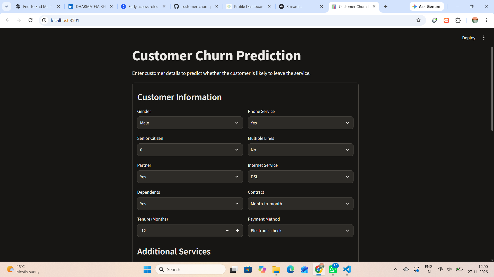
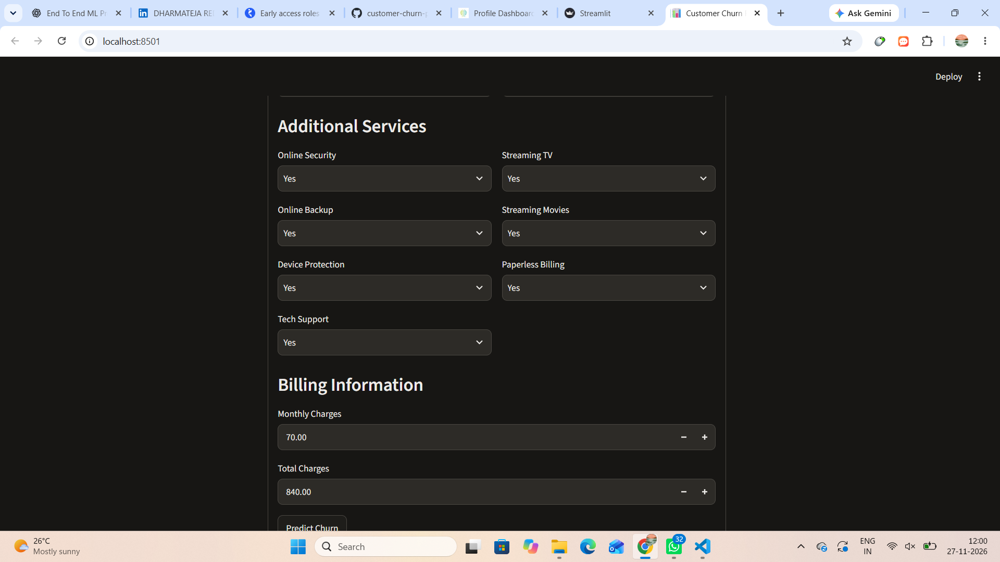
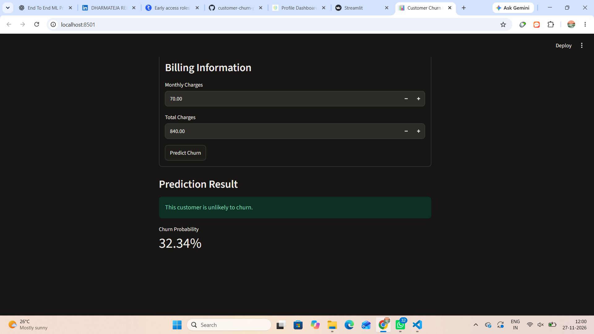

# Customer Churn Prediction

A machine learning project that predicts whether a telecom customer is likely to leave a service based on customer information, account details, and subscribed services.

The project uses the IBM Telco Customer Churn dataset and compares multiple classification algorithms before building an interactive web application using Streamlit.

## Live Application

**[Try the Customer Churn Prediction App](https://customer-churn-prediction-ahxcksoc8axzywzwu2zpwv.streamlit.app/)**

## Project Overview

Customer churn is an important business problem for telecom companies. Identifying customers who may leave a service can help businesses understand customer behavior and plan retention strategies.

The objective of this project is to build a machine learning model that identifies potential customer churn using historical customer data.

## Dataset

- **Dataset:** IBM Telco Customer Churn
- **Total records:** 7,043
- **Total columns:** 21
- **Target variable:** `Churn`
- **Source:** [Telco Customer Churn Dataset](https://www.kaggle.com/datasets/blastchar/telco-customer-churn)

## Technologies Used

- Python
- Pandas and NumPy
- Matplotlib and Seaborn
- Scikit-learn
- XGBoost
- Joblib
- Streamlit
- Jupyter Notebook

## Project Workflow

1. **Data Understanding:** Explored the dataset, identified data types, missing values, and target distribution.
2. **Data Cleaning:** Converted `TotalCharges` into a numeric column and handled blank values.
3. **Exploratory Data Analysis:** Studied customer churn patterns across tenure, contract types, payment methods, and other customer attributes.
4. **Preprocessing:** Used StandardScaler for numerical features and OneHotEncoder for categorical features.
5. **Model Training:** Trained Logistic Regression, Decision Tree, Random Forest, and XGBoost classifiers.
6. **Model Evaluation:** Compared models using accuracy, precision, recall, F1-score, and ROC-AUC.
7. **Hyperparameter Tuning:** Used GridSearchCV with stratified cross-validation to tune Logistic Regression and XGBoost.
8. **Deployment:** Saved the trained XGBoost pipeline and integrated it into a Streamlit application.

## Model Performance

### Initial Model Comparison

| Model | Accuracy | F1-score | ROC-AUC |
|---|---:|---:|---:|
| Logistic Regression | 80.55% | 60.40% | 0.8420 |
| Decision Tree | 71.82% | 47.42% | 0.6415 |
| Random Forest | 78.28% | 54.05% | 0.8196 |
| XGBoost | 80.70% | 58.91% | 0.8456 |

### Tuned XGBoost Model

| Metric | Result |
|---|---:|
| Accuracy | 77.50% |
| Precision | 55.93% |
| Recall | 71.93% |
| F1-score | 62.92% |
| ROC-AUC | 0.8450 |

The tuned XGBoost model achieved a higher recall and F1-score than the initial models, making it the selected model for the application.

**Note:** The test set was used during iterative model comparison and selection. Therefore, these results are exploratory rather than an independent final performance estimate.

## Streamlit Application
-The application allows users to enter customer details and receive:

-Predicted churn status.

-Estimated churn probability.


## Application Interface



## Billing Information



## Prediction Result




**Live Demo:** [Customer Churn Prediction](https://customer-churn-prediction-ahxcksoc8axzywzwu2zpwv.streamlit.app/)

## Project Structure

```text
customer-churn-prediction/
│
├── app/
│   └── app.py
│
├── data/
│   ├── raw/
│   └── processed/
│
├── models/
│   └── xgboost_churn_model.pkl
│
├── notebooks/
│   └── 01_data_understanding.ipynb
│
├── src/
├── tests/
│
├── .gitignore
├── README.md
└── requirements.txt
```

## Run Locally

### 1. Clone the repository

```bash
git clone https://github.com/Teja694/customer-churn-prediction.git
cd customer-churn-prediction
```

### 2. Create and activate a virtual environment

```bash
python -m venv .venv
```

Windows PowerShell:

```powershell
.\.venv\Scripts\Activate.ps1
```

### 3. Install dependencies

```bash
pip install -r requirements.txt
```

### 4. Run the Streamlit application

```bash
python -m streamlit run app/app.py
```

## Future Improvements

- Experiment with different classification thresholds.
- Perform additional model validation using an independent holdout dataset.
- Add automated tests for preprocessing and prediction.
- Explore further ways to improve churn detection.

## Author

**Dharma Teja Reddy Kothinti**

- GitHub: [Teja694](https://github.com/Teja694)
- LinkedIn: [Dharmateja Reddy Kothinti](https://www.linkedin.com/in/dharmateja-reddy-kothinti-0732aa388/)